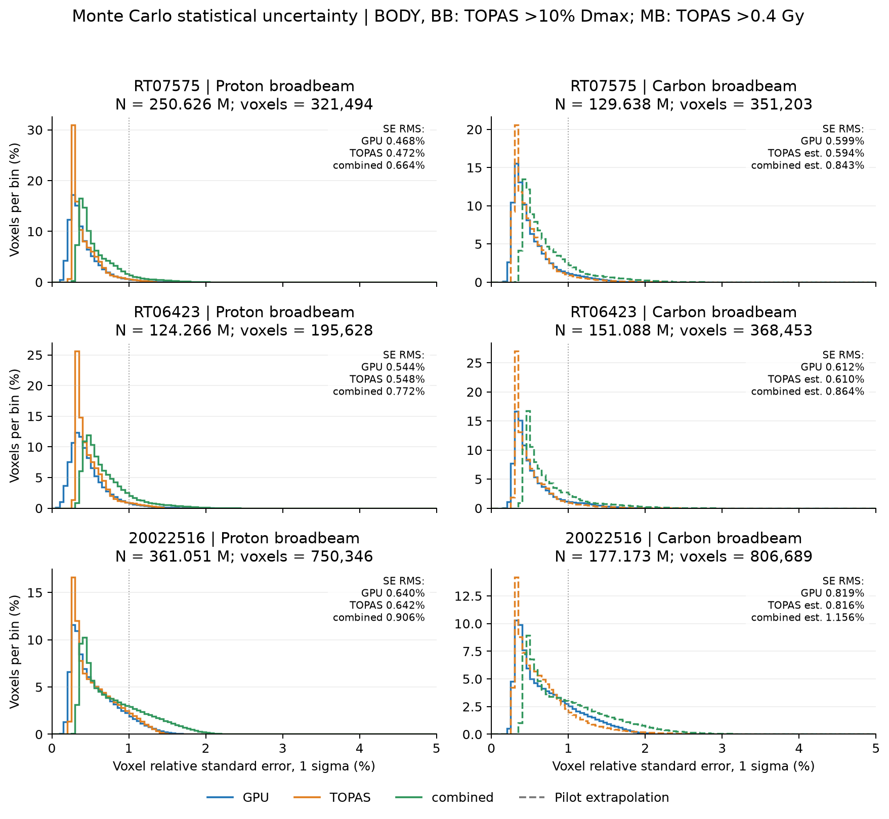
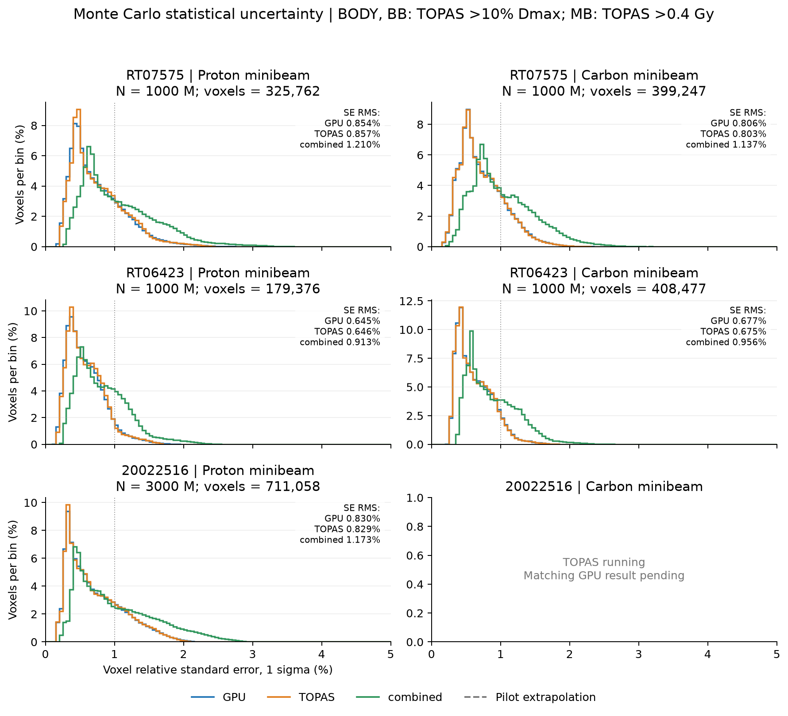
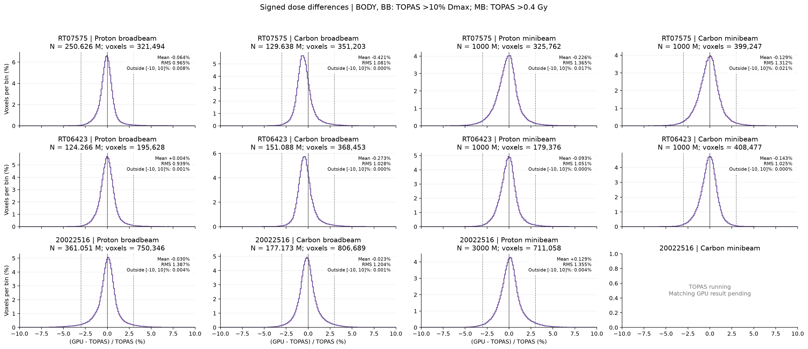

# Full-plan GPU/TOPAS validation and statistical uncertainty — 2026-10-17

Updated 2026-10-17T08:38:45 Asia/Shanghai. All11 completed GPU rows use identical current production source inventories; patient-specific geometry/source/weights preserved.

GPU rates: thousand histories/s per device, steady state. CPU: single56-thread node; historical values retained, except RT06423 carbon minibeam current1B measured equivalent node rate.

Cold: fresh process through first saved batch, including input/package loading, excluding compilation. Native AOT, PTX JIT disabled.

## Broadbeam: BODY and TOPAS >10% global TOPAS Dmax

|Case|Modality|GPU/TOPAS histories each|local3%/3mm|local1%/1mm|local3%/0mm|CPU56 k/s|2080Ti warm k/s|A6000 warm k/s|GPU SE RMS|TOPAS SE RMS|Combined SE RMS|
|---|---|---:|---:|---:|---:|---:|---:|---:|---:|---:|---:|
|RT07575|Proton broadbeam|250,626,500|100.00%|99.99%|98.47%|—|731.0|1253.2|0.468%|0.472%|0.664%|
|RT06423|Proton broadbeam|124,266,340|100.00%|99.99%|98.85%|10.7|736.2|1330.0|0.544%|0.548%|0.772%|
|20022516|Proton broadbeam|361,050,622|100.00%|99.45%|94.73%|6|546.6|965.2|0.640%|0.642%|0.906%|
|RT07575|Carbon broadbeam|129,638,170|100.00%|99.77%|98.46%|0.409|156.7|290.5|0.599%|0.594%*|0.843%*|
|RT06423|Carbon broadbeam|151,087,660|100.00%|99.85%|98.41%|—|168.3|315.4|0.612%|0.610%*|0.864%*|
|20022516|Carbon broadbeam|177,173,040|100.00%|99.96%|96.86%|0.288|145.5|279.9|0.819%|0.816%*|1.156%*|

Gamma search increment: 0.1mm.

## Minibeam: BODY and TOPAS >0.4 Gy

|Case|Modality|GPU/TOPAS histories each|local3%/0.2mm|local3%/0.1mm|local3%/0mm|CPU56 k/s|2080Ti warm k/s|A6000 warm k/s|GPU SE RMS|TOPAS SE RMS|Combined SE RMS|
|---|---|---:|---:|---:|---:|---:|---:|---:|---:|---:|---:|
|RT07575|Proton minibeam|1,000,000,000|99.82%|99.28%|95.77%|—|321.6|556.4|0.854%|0.857%|1.210%|
|RT06423|Proton minibeam|1,000,000,000|99.97%|99.79%|98.44%|—|349.4|602.9|0.645%|0.646%|0.913%|
|20022516|Proton minibeam|3,000,000,000|99.57%|98.24%|95.54%|—|346.2|585.9|0.830%|0.829%|1.173%|
|RT07575|Carbon minibeam|1,000,000,000|99.72%|99.39%|96.48%|—|71.8|111.3|0.806%|0.803%|1.137%|
|RT06423|Carbon minibeam|1,000,000,000|99.92%|99.85%|98.75%|1.058|63.0|98.8|0.677%|0.675%|0.956%|
|20022516|Carbon minibeam|TOPAS saved 392,547,523/1B; GPU pending|—|—|—|—|—|—|—|—|—|

Gamma search increment: 0.02mm.

## Cold versus steady-state GPU throughput

k histories/s, cold / steady. Proton batches20M; carbon broadbeam about5M; carbon minibeam about2.5M.

|Case|Modality|2080Ti cold / steady|A6000 cold / steady|L4 cold / steady|
|---|---|---:|---:|---:|
|RT07575|Proton broadbeam|730.2 / 731.0|1184.7 / 1253.2|—|
|RT06423|Proton broadbeam|731.0 / 736.2|1231.9 / 1330.0|—|
|20022516|Proton broadbeam|551.4 / 546.6|924.0 / 965.2|—|
|RT07575|Carbon broadbeam|160.5 / 156.7|288.5 / 290.5|—|
|RT06423|Carbon broadbeam|166.4 / 168.3|301.4 / 315.4|—|
|20022516|Carbon broadbeam|146.4 / 145.5|266.2 / 279.9|245.6 / 257.9|
|RT07575|Proton minibeam|331.9 / 321.6|554.7 / 556.4|496.8 / 527.0|
|RT06423|Proton minibeam|362.6 / 349.4|577.4 / 602.9|—|
|20022516|Proton minibeam|350.6 / 346.2|553.4 / 585.9|—|
|RT07575|Carbon minibeam|65.0 / 71.8|75.2 / 111.3|—|
|RT06423|Carbon minibeam|58.9 / 63.0|70.7 / 98.8|69.0 / 106.2|

## Statistical uncertainty

Voxel relative standard error RMS (one sigma), within the corresponding gamma evaluation mask: BODY and TOPAS >10% global Dmax for broadbeam; BODY and TOPAS >0.4Gy for minibeam. All relative errors use the TOPAS voxel dose as denominator: 100*sqrt(mean(variance/TOPAS_dose^2)). Combined variance is GPU variance + TOPAS variance, assuming independent simulations. GPU SE is estimated from independent batches; TOPAS SE uses native per-history variance. This is not the uncertainty of the ROI mean and does not bound every voxel. Historical carbon broadbeam TOPAS references lack stored native variance. Entries marked * are estimates extrapolated from a new matched300k-history TOPAS pilot to the original full-campaign particle count, cross-checked against the original independent replicas; pooled-spot native variance is conservative for a stratified source. No original dose/gamma values are changed.

|Case|Modality|GPU|TOPAS|Combined|
|---|---|---:|---:|---:|
|RT07575|Proton broadbeam|0.468%|0.472%|0.664%|
|RT06423|Proton broadbeam|0.544%|0.548%|0.772%|
|20022516|Proton broadbeam|0.640%|0.642%|0.906%|
|RT07575|Carbon broadbeam|0.599%|0.594%*|0.843%*|
|RT06423|Carbon broadbeam|0.612%|0.610%*|0.864%*|
|20022516|Carbon broadbeam|0.819%|0.816%*|1.156%*|
|RT07575|Proton minibeam|0.854%|0.857%|1.210%|
|RT06423|Proton minibeam|0.645%|0.646%|0.913%|
|20022516|Proton minibeam|0.830%|0.829%|1.173%|
|RT07575|Carbon minibeam|0.806%|0.803%|1.137%|
|RT06423|Carbon minibeam|0.677%|0.675%|0.956%|

[Statistical uncertainty method and pilot cross-check](uncertainty.md). Figures below are tracked as PNG/PDF. Raw Monte Carlo outputs, full histogram CSV, voxel-level NPZ and SVG remain in the local ignored experiment directory.

RT07575 carbon minibeam TOPAS retains the original seven-module historical physics without GenericIon nuclear elastic; current GPU enables medium elastic. No dose fitting/registration applied.

Carbon broadbeam TOPAS references retain their original TPS plan weights; the reported gamma compares the corresponding same-weight GPU plans.

## Distributions

Blue: GPU; orange: TOPAS; green: independent combined SE. Dashed curves are carbon broadbeam pilot extrapolations. Histograms use the same fixed gamma masks as the tables; no SE-based voxel exclusion is applied.

Signed dose differences include statistical and systematic effects and must not be interpreted as pure statistical uncertainty.

## Provenance

The current CMake/config/C++ source inventory exactly matches [source_sha256.json](source_sha256.json). All eleven completed GPU comparisons share that inventory. [results.json](results.json) preserves numerical results, timings and estimate labels; [statistics.json](statistics.json) preserves uncertainty distributions, pilot audits and independent-replica cross-checks. Local evidence paths in JSON use `${WORKSPACE}` / `${EXTERNAL_ASSETS}` placeholders; these are provenance references, not assets distributed with the repository.

Raw patient, source and Monte Carlo data are external assets. Original experiment evidence remains under `tmp/full_plan_summary_20261017/` and the campaign directories referenced there. The CPU throughput values retain the historical/current distinction in the table metadata.
